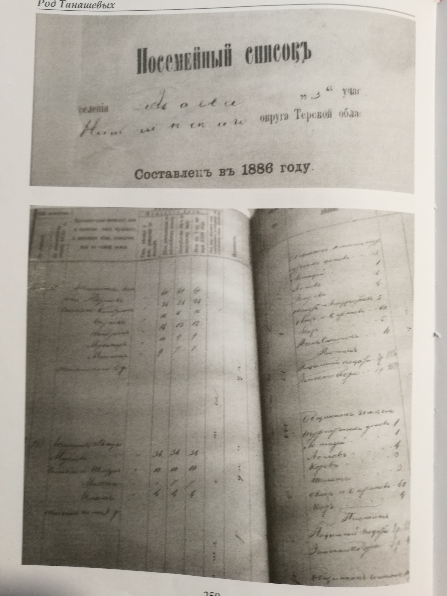
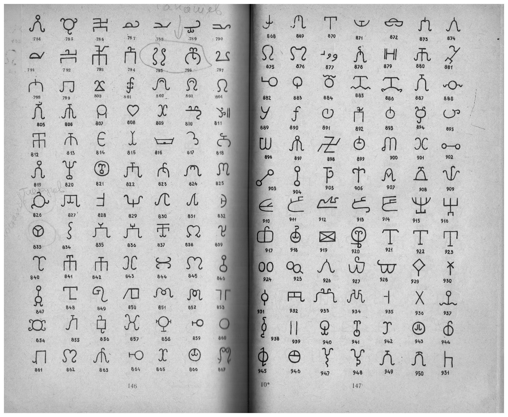

# Сканы документов

Витрина сканированных копий, на которые опираются статьи проекта. Каждый документ
снабжён архивным шифром — по нему оригинал можно найти самостоятельно.
Документы сгруппированы по типу источника и хронологии.

> Статус помечает, как документ используется в реконструкциях:
> **подтверждено** — прямо фиксирует событие или дату;
> **контекст** — подтверждает фон (географию, имена, должности), но не веху напрямую;
> **в работе** — ожидает расшифровки и привязки к карточкам персон.

## Первоисточники XIX века

### Посемейные списки селения Абаево (1886)

- **Тип:** посемейный список — один из базовых источников по составу дворов и поколенной структуре второй половины XIX века.
- **Миниатюра:**
  
  

  
- **Файл:** [Открыть скан в полном размере (JPEG)](https://raw.githubusercontent.com/RTS929/tanashev-genealogy/main/docs/assets/1886%20Посемейные%20списки%20селения%20Абаево.jpg)
- **Значение:** уточняется — ожидает расшифровки и сверки с карточками персон (поиск упоминаний ветвей рода).
- **Статус:** в работе

---

## Справочные издания

### Яхтанигов Х. М. «Северокавказские тамги» — лист книги

- **Тип:** скан страницы из каталога тамговых знаков. Каталог Яхтанигова используется в проекте как основной справочник по тамгам: именно на нём основан вывод об отсутствии прямых совпадений у абазинской тамги Танашевых и об отдельном совпадении с тамгой рода Шармат.
- **Миниатюра:**

  

- **Файл:** [Открыть скан в полном размере (JPEG)](https://raw.githubusercontent.com/RTS929/tanashev-genealogy/refs/heads/main/docs/assets/Скан%20листа%20книги%20Яхтанигова%20Северокавказские%20тамги.jpeg)
- **Значение:** иллюстрирует страницу каталога, на которую опирается аргументация в разделе «Источники и ссылки».
- **Статус:** контекст

---

Документы по фондам РГАДА, СПбИИ РАН и ЦГА КБР добавляются по мере сканирования. Полный список архивных шифров — в [архивных шифрах](archives.md). Спорные интерпретации сканов обсуждаются через [Issues](https://github.com/RTS929/tanashev-genealogy/issues).

<!-- Шаблон для нового документа: скопируйте блок и заполните поля.

### Название документа (год)

- **Тип:** описание вида источника (метрическая книга, приговор суда, отписка…)
- **Шифр:** фонд, опись, ед. хр.
- **Миниатюра:**

  

- **Файл:** [Открыть скан в полном размере](https://raw.githubusercontent.com/RTS929/tanashev-genealogy/refs/heads/main/docs/assets/имя%20файла.jpg)
- **Значение:** что подтверждает или иллюстрирует
- **Статус:** подтверждено / контекст / в работе
-->
